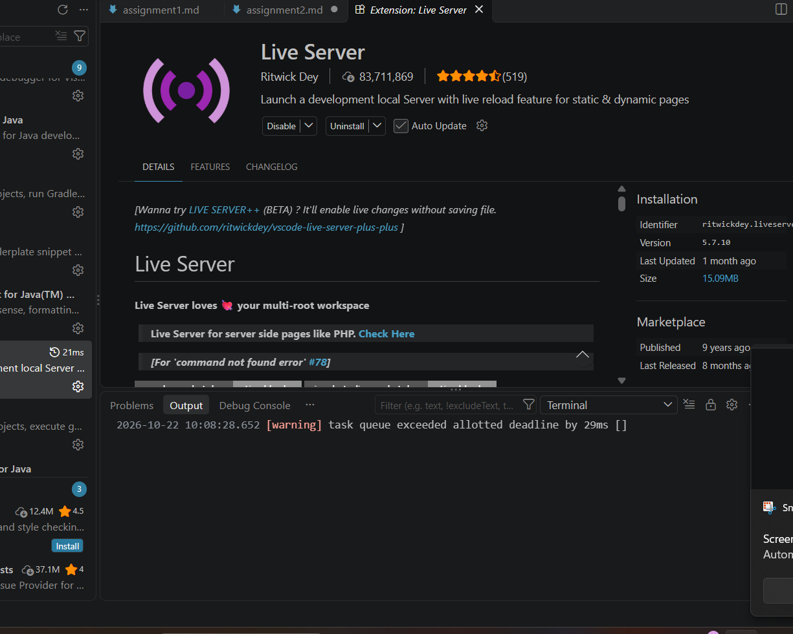

# Task 2:Install VS code, Node.js, and Live sercer?
1. VS Code

Visual Studio Code (VS Code) is a code editor used to write and manage code. I use it to create and edit my HTML, CSS, and JavaScript files.

2. Node.js

Node.js is a JavaScript runtime that allows JavaScript code to run outside a web browser. It is useful for web development.

3. Live Server

Live Server is a VS Code extension that runs an HTML page on a local development server. It automatically refreshes the browser when I save changes to my code.

4. Verification

I will verify that VS Code is installed, Node.js is working, and Live Server runs my HTML page successfully.

Proof:-
